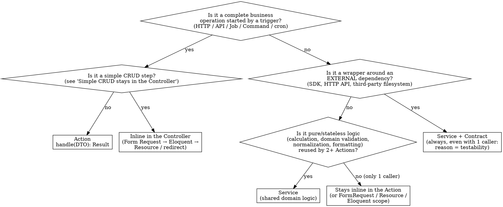

# Action vs Service

## Principle

**The Action is the business operation. The Service is a piece of pure, stateless, reusable logic — or a wrapper around an external dependency.**

The orchestration logic of an operation lives *in the Action*, not in a dedicated Service. A Service exists only when there is real reuse (2+ callers) or when an external dependency must be encapsulated for testability. No layers for hypothetical future needs.

This model is the dominant one in the Laravel community (Spatie, Lorisleiva, Nuno Maduro): *fat action, reusable service*. It is not the framework's "core default" — Laravel core has neither an Action nor a Service layer — but it is the reference convention for structured projects.

## The Action as a uniform entry point

An Action is **context-free**: the same code is invoked from HTTP, console, Job or scheduler without changes. The caller prepares a typed DTO, invokes `handle()`, and receives a typed result.

```php
namespace App\Contracts;

/**
 * Common contract for all Actions.
 *
 * Generics live only in PHPDoc: PHP has no runtime generics,
 * type safety is provided by PHPStan/Psalm at a high level.
 *
 * @template TInput
 * @template TOutput
 */
interface Action
{
    /**
     * @param TInput $input
     * @return TOutput
     */
    public function handle(mixed $input): mixed;
}
```

Each Action declares its concrete types in its own docblock:

```php
namespace App\Actions\Users;

/**
 * @implements Action<RegisterUserData, User>
 */
final class RegisterUser implements Action
{
    public function __construct(
        private readonly SubscriptionService $subscriptions,
    ) {}

    public function handle(mixed $input): User
    {
        return DB::transaction(function () use ($input) {
            $user = User::create([
                'name'  => $input->name,
                'email' => $input->email,
            ]);
            $user->assignRole('customer');

            // orchestration logic: it lives HERE, not in a Service
            $this->subscriptions->startTrial($user);

            event(new UserRegistered($user)); // optional side-effect → queued Listener
            return $user;
        });
    }
}
```

**Why `handle()` and not `__invoke()`:** `handle()` is the Laravel core convention for a unit of work (Job, Command, Listener, Notification). With a common typed interface it is more readable for static analysis and enables an optional generic action bus. `__invoke()` remains the convention for invokable controllers, not for Actions.

## Decision: where do I put this logic?



## Quick Reference

| Type | When | Shape | Reuse |
|---|---|---|---|
| **Inline in the Controller** | Simple CRUD with a single caller: one model written, or a simple read ([criteria](#simple-crud-stays-in-the-controller)) | Form Request → Eloquent → Resource / redirect | None: no second caller |
| **Action** | Complete business operation invocable from Controller/Job/Command/scheduler. Contains the orchestration. It is the default as soon as the operation is more than a simple CRUD. | `class Xxx implements Action { public function handle(TInput): TOutput }` | Low: 1 Action = 1 operation |
| **Service (domain)** | **Pure, stateless logic reused by 2+ Actions** — calculations, domain rules, validations, normalizations, formatting | Concrete class with stateless public methods, injected directly (Contract only in the cases of rule 4) | Medium-high |
| **Service (wrapper)** | Wrapper around an **external dependency** — SDK, HTTP API, third-party filesystem/queue — **always**, even with only 1 caller | Class implementing a Contract, injected into the Actions | Low is OK: reason = testability, not reuse |

## Non-negotiable rules

1. **Action = operation, not an empty container.** The orchestration (creating records, assigning roles, coordinating multiple Services, managing the transaction, emitting events) lives in the Action. Do not move it into an "orchestration" Service — that is the anemic service anti-pattern.
2. **An Action has `handle()`**, defined by the `Action<TInput, TOutput>` interface. Never `execute()`, `run()`, or `__invoke()`. One class = one operation = one public method.
3. **Service = stateless.** No mutable properties between calls. If state is needed, it is an Action or a Job.
4. **A Contract only when it pays for itself.** An interface in `App\Contracts\...`, bound in the `ServiceProvider`, is introduced when:
   - it encapsulates an external dependency (API, payment gateway, storage) that must be replaced in tests;
   - two or more implementations already exist;
   - a module exposes an extension point to other modules.

   In all other cases the Action injects the concrete Service: the container resolves it anyway.
5. **Thin Controller, not an empty one.** A simple CRUD step stays in the Controller with Eloquent ([criteria](#simple-crud-stays-in-the-controller)); anything more goes through `FormRequest` → `DTO` → `$action->handle($dto)` → `Resource`, with no logic after the Action invocation other than response mapping. Never SDK calls, `DB::` or transactions in the Controller.
6. **Optional side-effects** (email, analytics, webhooks) → queued `Event` + `Listener`. Not synchronous inside the Action. If Segment is down, registration does not fail.
7. **Typed DTO** (`spatie/laravel-data` or a readonly class) between `FormRequest` and Action. Never loose arrays.
8. **No Use Cases.** Complex workflows are Actions that orchestrate multiple Services and/or sub-Actions. No dedicated intermediate layer.

## Decision rules with examples

### Simple CRUD stays in the Controller

An Action that only wraps `Post::create($data)` is a passthrough: one more file, no added meaning. The Controller works with Eloquent directly when **all** of these hold:

- **One caller**: no Job, Command, API endpoint or other Controller performs the same operation.
- **One model written** (`create`, `update`, `delete` with `$request->validated()`, relations set through the bound parent) **or a simple read** (route model binding, `load()`, existing scopes, `paginate()`).
- **No transaction, no external call, no domain event, no state guard** beyond what the Policy already checks.

```php
public function store(StorePostRequest $request): RedirectResponse
{
    $post = $request->user()->posts()->create($request->validated());

    return to_route('posts.show', $post);
}

public function index(): Response
{
    return Inertia::render('Posts/Index', [
        'posts' => PostResource::collection(Post::query()->published()->latest()->paginate()),
    ]);
}
```

**Extract an Action as soon as one condition fails**: a second model or table is written, a transaction is needed, the operation checks the state (`$order->status->canBeCancelled()`), dispatches an event or calls an external service, a second caller appears, or the method stops being readable at a glance. Reads follow the same idea: a filter chain used in two places becomes a scope or Builder, an index with user-driven filters becomes a Query Object.

When the operation grows, the inline code moves into an Action unchanged: the extraction is cheap, so do not anticipate it.

### → Action

> "Register a user", "Publish a post", "Cancel an order", "Full checkout", "Import a CSV of customer records"

Even a complex workflow stays an Action: it orchestrates the steps, delegates calculations to Services, and decides where the transaction starts and ends.

```php
/**
 * @implements Action<CheckoutData, Order>
 */
final class Checkout implements Action
{
    public function __construct(
        private readonly PricingService $pricing,   // reused pure logic
        private readonly PaymentGateway $payments,   // external SDK wrapper
    ) {}

    public function handle(mixed $input): Order
    {
        $total = $this->pricing->calculate($input->cart, $input->coupon);

        // 1. local writes only: the order exists, but is not paid yet
        $order = DB::transaction(fn (): Order => Order::create([
            ...,
            'total'  => $total,
            'status' => OrderStatus::PendingPayment,
        ]));

        // 2. essential external call after commit: no rollback can erase it
        try {
            $this->payments->capture($order, $total); // idempotency key = order id
        } catch (PaymentFailed $e) {
            $order->update(['status' => OrderStatus::PaymentFailed]);
            throw OrderException::paymentFailed($order, $e);
        }

        // 3. confirm, then optional side-effects
        $order->update(['status' => OrderStatus::Paid]);
        event(new OrderPlaced($order));

        return $order;
    }
}
```

Note: `Checkout` has 3+ steps and potential branching, but it stays an Action. In the old model it would have been a "Use Case" — not needed.

Why the pending state: the payment is an **essential** external call, so it is neither inside a transaction that could still roll back (money captured, order gone) nor in a fire-and-forget listener (order confirmed, money never captured). The DB always tells the truth: `PendingPayment`, `PaymentFailed` or `Paid`. If the process dies between commit and capture, the order stays `PendingPayment`: a scheduled Job reconciles it with the provider, and the idempotency key prevents a double charge on retry.

### → Service (external wrapper)

> Wraps the Stripe SDK, a third-party HTTP client, a custom S3 client, a PDF parser.

**Always** create Service + Contract, even with only 1 caller. The reason is testability and replaceability: never call an external SDK directly in an Action.

```php
// App\Contracts\PaymentGateway  (interface)
// App\Services\Payments\StripeGateway  implements PaymentGateway
// binding in the ServiceProvider
```

### → Service (domain)

> `PricingService::calculate()`, `TaxService`, an address normalizer, an IBAN formatter.

Create a Service **only with 2+ real callers**. It is pure, stateless logic with no side-effects. With a single caller: the logic stays in the Action (or in a private method of the Action).

No Contract: inject the concrete class, and use it for real in tests (pure logic needs no mock). Introduce an interface only when a second implementation actually exists (e.g. two pricing strategies) or when another module must be able to replace it.

### → Stays inline

`unique` validation, authorization, simple Eloquent queries, response formatting → live in `FormRequest`, `Policy`, Eloquent scopes, `Resource`. There is no need for a Service "for tidiness".

## Rationalizations to reject

| Temptation | Reality |
|---|---|
| "I'll move all of the operation's logic into a Service, the Action just passes things along" | No. This produces anemic/passthrough services. Orchestration is the Action's job. The Service is for *pure and reused* pieces, not for the whole operation. |
| "I'll extract a domain Service right away, it might come in handy" | YAGNI. Logic stays in the Action until you have 2+ real callers. |
| "I'll use `execute()` / `__invoke()`, it's more explicit" | No. The convention is `handle()` from the `Action` interface. Explicit = the class has a single public method. |
| "I'll make a stateful Service with properties" | No. Service = stateless, idempotent per call. Need state → Action or Job. |
| "I'll call the Stripe SDK directly in the Action" | No. External SDKs always behind a Contract — testability + replaceability. |
| "I'll put an interface on every Service, it's cleaner" | No. An interface with one implementation and no external dependency is noise: inject the concrete class. |
| "I'll send the email synchronously inside the Action" | No, if it is an optional side-effect: queued Event + Listener. The Action fails only for what is essential to transactional consistency. |
| "Every endpoint gets an Action, for consistency" | No. An Action around a single `Model::create()` is a passthrough. Simple CRUD stays in the Controller until one of the [criteria](#simple-crud-stays-in-the-controller) fails. |
| "It's just one more `update()`, I'll leave the transaction in the Controller" | No. Two writes, a transaction or a state guard make it an operation: it goes into an Action. |
| "The workflow is complex, I'll create a Use Case layer" | No. It stays an Action that orchestrates Services and sub-Actions. No Use Case layer. |

## Red flags — stop and rethink

- A **Service with a single caller** that does not wrap an external dependency → it is not a Service; the logic goes back into the Action.
- A Service that **orchestrates an entire operation** (creates records + coordinates + emits events) → it is a disguised Action. Operations are Actions.
- The Service has **state** (mutable properties between calls) → it is not a Service.
- The Controller has **logic after `$action->handle(...)`** other than response mapping → it belongs in the Action.
- The Controller writes **two or more models**, opens a transaction, checks the state or dispatches events → it is an operation: extract the Action.
- An Action whose `handle()` is a **single `create`/`update`/`delete`** with one caller → passthrough: move it back into the Controller.
- An Action calls another Action → composition is OK; but if it becomes a deep chain of 3+ sub-Actions, revisit the boundaries.
- The same logic **duplicated in 2+ Actions** → *now* is the time to extract a Service, not before.
- An Action with **`handle()` > ~50 lines** → extract named private methods, or a sub-Action, or a domain Service if the logic is pure and reusable.

## File layout (convention)

```
app/
├── Contracts/
│   ├── Action.php                    # common generic interface
│   └── PaymentGateway.php            # external wrapper contract
├── Actions/
│   ├── Users/
│   │   └── RegisterUser.php          # implements Action<RegisterUserData, User>
│   └── Orders/
│       └── Checkout.php              # implements Action<CheckoutData, Order>
├── Services/
│   ├── Payments/
│   │   └── StripeGateway.php         # implements PaymentGateway (wrapper)
│   └── Pricing/
│       └── PricingService.php        # concrete domain service, no interface
├── Data/                             # typed DTOs
│   ├── Users/
│   │   └── RegisterUserData.php
│   └── Orders/
│       └── CheckoutData.php
├── Events/
│   └── UserRegistered.php
└── Listeners/
    ├── SendWelcomeEmail.php          # ShouldQueue
    └── TrackUserRegistered.php       # ShouldQueue
```

## Checklist when adding an endpoint

1. `FormRequest` for validation + authorization
2. Is it a [simple CRUD step](#simple-crud-stays-in-the-controller)? Yes → the Controller calls Eloquent with `$request->validated()` and returns a Resource or redirect; skip to step 7. No → continue.
3. `DTO` (readonly) for the validated data
4. Controller: `return new Resource($action->handle($dto))`; `Action` with `handle()` — orchestrates the operation, manages the transaction, delegates pure calculations to Services
5. `Service` only for external wrappers (behind a Contract) or pure logic reused by 2+ Actions (concrete class)
6. Queued `Event` + `Listener` for optional side-effects
7. `Resource` for the response
8. Tests: feature test on the endpoint; for an Action, also a test on the Action (external dependencies replaced via their Contract or Laravel's fakes, domain Services used for real)
